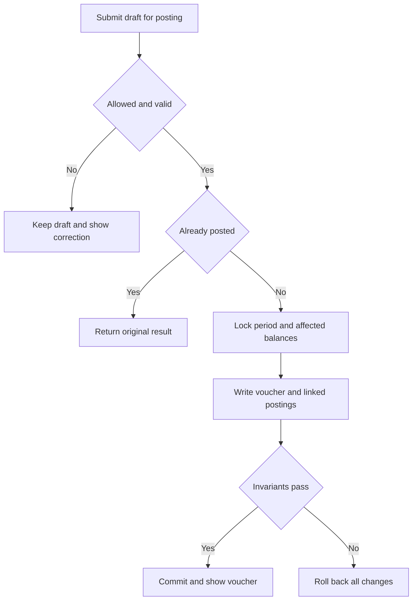
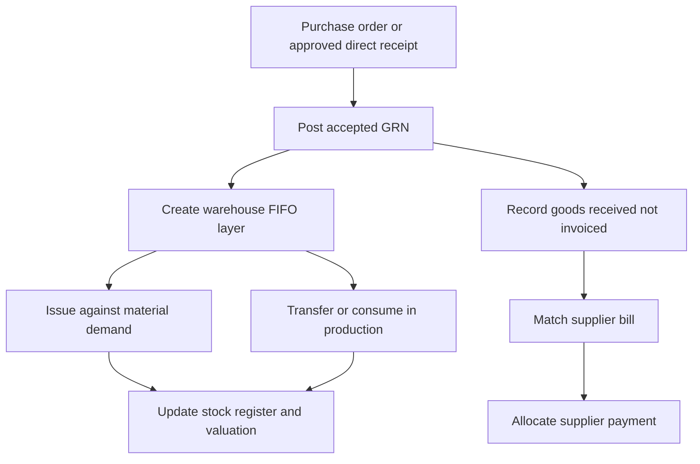
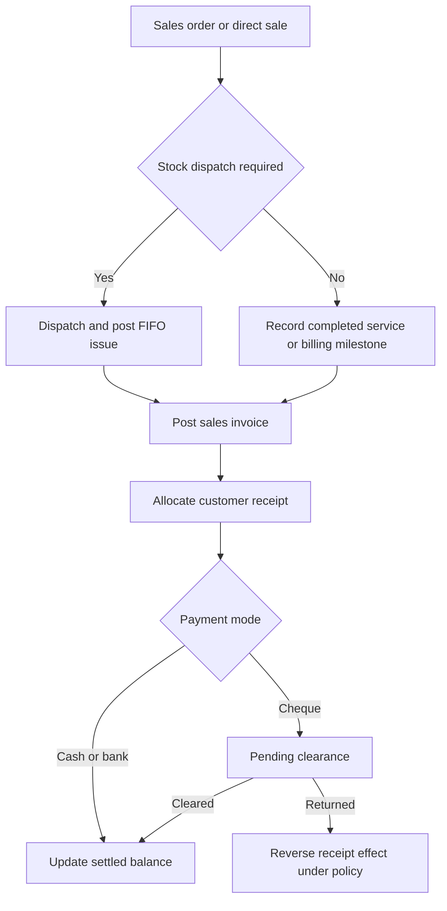

# Industrial ERP · Workflows and accounting

## Posting model

Treat the current README’s PO approval and order confirmation posting descriptions as issues to verify. A commitment, a physical stock movement, a bill, and settlement are separate business events. Each event should have one documented owner in the backend. The proposed entries below are for representative transactions and require the client accountant’s approval, including revenue recognition, goods in transit, recoverable taxes, cheque handling and timing differences. [IFRS 15 revenue recognition](https://www.ifrs.org/issued-standards/list-of-standards/ifrs-15-revenue-from-contracts-with-customers/) · [IAS 2 inventory](https://www.ifrs.org/issued-standards/list-of-standards/ias-2-inventories/) · [ERPNext accounting event mapping](https://docs.frappe.io/erpnext/accounting-entries)

For every posted document, persist the voucher, relevant stock movements and FIFO allocations, balanced journal entries, allocations and audit results together in one transaction. The UI reads the committed result. Operational notifications can run afterwards. If required work must run outside the transaction, persist a retryable outbox record with the original commit and use an idempotent handler.

Documents use a draft and posted lifecycle with an explicit approved state where the maker/checker policy requires it. A correction after posting creates a linked reversal, return or credit/disbursement adjustment. Read and post against open periods with server-side checks. Capture business date separately from audit timestamps. A transaction's workflow permissions include the correct company, branch/warehouse, account and action.

## Purchase, stock and issue

| Event | Quantity and valuation | Proposed financial effect |
| --- | --- | --- |
| Approve PO | Commitment/open order quantity. | Keep approval and commitments separately from actual postings. |
| Post GRN | Accepted quantity goes to available stock and a FIFO layer. Rejected quantity is recorded and segregated per client policy. | For a typical receipt before billing, Dr Inventory, Cr Goods Received Not Invoiced (GRNI). The combined bill-and-receipt path must create the same stock only once. |
| Post supplier bill | Match PO and accepted GRN quantities and verify supplier invoice identity. Permit partial bills under policy. Record services directly to their account when appropriate. | Clear the matched GRNI, record applicable input tax and any accountant-approved variance, and Cr Vendor AP. |
| Pay supplier | Store payment mode, bank/cash account, allocation and actual reference. | Dr Vendor AP, Cr Bank/Cash or appropriate clearing. Model advances separately. |
| Material issue | Verify request, remaining authorized quantity, warehouse availability and base-unit conversion. Allocate oldest eligible layers. | Dr Department Expense or WIP, Cr Inventory. |
| Transfer or manufacture | Transfer out and in with cost traceability. For production, link consumption, yield, reject/scrap and finished receipt. | Keep warehouse transfer value balanced across affected inventory accounts when journals are required. Apply approved WIP, finished goods and variance treatment. |

FIFO uses item and warehouse layers, ordered by business chronology and a stable sequence. Store physical lot traceability separately where needed. A transfer preserves allocated source cost and provenance. Agree with Accounts on effective aging in the receiving warehouse. Returns and reversals refer to original layers, movements and journals where still reversible. Block an invalid reversal with dependents and direct staff to the approved correction flow. The stock register derives opening as of the start of the range and lists movements by effective date and sequence. Report both quantity and valuation and support drill-down to the GRN, issue, transfer, adjustment or dispatch. [ERPNext stock ledger behavior](https://docs.frappe.io/erpnext/stock-ledger)

## Sales, receipts and cheque lifecycle

- **Order and dispatch.** Reserve on order confirmation where used. Dispatch the stock once and calculate FIFO cost for the affected items. Dr COGS / Cr Inventory at the approved event. If a direct invoice both dispatches and bills, post both effects in the same transaction. An invoice linked to an already posted dispatch reuses those stock effects. Validate cumulative billed quantities and prevent duplicate dispatch or billing.
- **Invoice.** On the typical completed sale, Dr AR for gross value, Cr Revenue for net sale and Cr Output Tax for the applicable amount. Store invoice-time customer tax fields and bill-to details, line description, quantity/rate/tax, numbering, date, and order/dispatch references. Revenue and invoice timing can differ. Use an accountant-approved path for deposits, timing differences, credit notes and returns.
- **Receipt.** Record cash received, eligible tax withheld by the customer, currency and bank/cash/cheque details. Allocate to one or more open invoices using available balances. Withholding recorded as a recoverable/prepaid amount requires the approved account and evidence policy. Unallocated receipts and advances follow a separate configuration. Preserve allocation changes and reversals in history. An invoice shows outstanding, partly settled and cleared amounts as applicable.
- **Cheque.** Choose with Accounts whether posting uses an uncleared-cheque account or records settlement only on clearing. Track pending, cleared and returned independently from bank reconciliation. Model clearing and return as their own posting actions where financial effects exist. Return/reversal restores the correct outstanding invoice or supplier balance.

## Salaries, wages, expenses and ledgers

| Workflow | Expected outcome |
| --- | --- |
| Monthly salary | Compute gross, deductions and net with effective pay-head snapshots. Prevent duplicate accruals for an employee/period under the same run type. Post salary expense and employee/statutory payables. Disbursement clears the relevant payable. |
| Daily wages | Enter employee, approved rate and days for the wage period. Support fractional days only if approved. Validate overlaps with payroll/other wage runs under the chosen policy. Use separate accrual and payment effects. |
| Sundry and utilities | Choose date, payee, expense/utility head, amount, payment account and applicable tax treatment. For a booked bill, settlement clears the balance. Direct cash expense posts to the approved expense and cash accounts. |
| Fixed assets | Link purchase or direct acquisition to fixed asset accounting as approved. Record asset cost and provenance. Agree on cutoff, depreciation, disposal and integration scope before these buttons appear. |
| Vendor/customer/employee/tax statements | Read posted journal and allocation data with appropriate party/head/account dimensions. Display debit/credit, opening balance, period activity and closing. Tie control totals to GL. Restrict employee details to authorized payroll or finance staff. |
| Stock statements | Read stock movements and layer allocations. Report opening, inward/outward, closing and value as of the selected dates. Reconcile total valued inventory against inventory GL by the configured posting scope. |

Use due and overdue reports backed by open item balances. Treat one supplier/consumer entity that fills multiple roles according to master data and its approved account dimensions. For taxes and withholdings, use [04_Statutory_Payments_Pakistan.md](04_Statutory_Payments_Pakistan.md). For acceptance examples, use [06_Agent_Implementation_and_Acceptance.md](06_Agent_Implementation_and_Acceptance.md).
