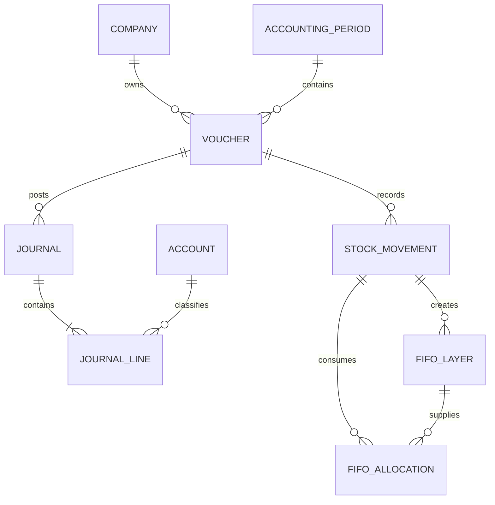
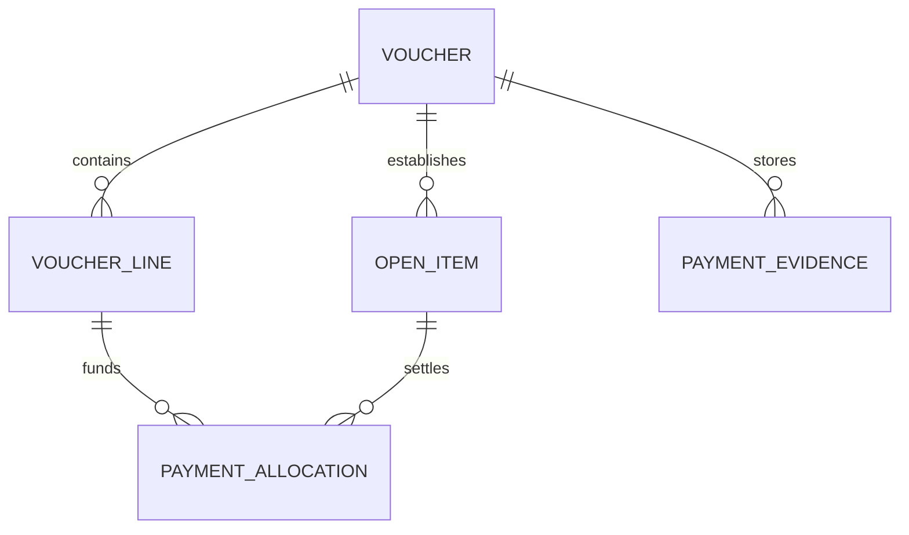

# Industrial ERP · Database specification and migrations

## Source-first implementation

The README reports Prisma with PostgreSQL, tenant context, a chart of accounts, journal lines, stock history and Prisma migrations. Open `backend/prisma/schema.prisma`, migration SQL, and services before creating a model. Map the names below to existing entities and conform to the real naming and ID strategy. Extend the existing journal, stock ledger and master tables. The diagram and tables describe relationships and invariants for the target design. Apply changes through reviewed migrations with real-data rehearsal.

## Target relationships

Use a common voucher identity if an equivalent registry exists or if the repo needs one for strict foreign keys. Keep type-specific documents and line fields. Represent an `OPEN_ITEM` as a canonical receivable, payable or statutory obligation if the current schema supports it. Separate allocation tables are also acceptable when their foreign keys, caps and reconciliation rules are explicit. Avoid a generic unvalidated `referenceId` for financial allocations.

| Entity or extension | Key data | Constraints and important indexes |
| --- | --- | --- |
| Company, branch, party, employee, item, unit, warehouse | Reuse masters. Model effective unit conversion, document-time tax details and optional per-warehouse stock policy. | Scope natural keys to company or branch as approved. Use same-company foreign keys for nested records where practical and enforce warehouse membership server-side. |
| Voucher / document identity | ID, company, branch, type, status, document number, business date, recorded time, actor, revision, linked source/reversal | Unique displayed number in its configured company/type/series scope. Sequence allocation is transactional. Read/list index on company, type, business date and cursor ID. |
| Posting request | Company, action, source ID, idempotency key, payload hash, result ID | Unique company/action/request key and a separate unique company/source/action occurrence. A second legitimate event such as cheque clear or partial posting has its own explicit identity. Same key with different payload is a conflict. |
| Accounting period, journal and lines | Company, dates, status, source voucher, accounts, signed effect through debit/credit columns, party dimension, tax head, actor | Per-line check: exactly one side positive, other zero. Require at least two valid lines and equality of total debits and credits at posting. Enforce at the service boundary and add a reviewed DB enforcement strategy if other write paths can post. Index company/account/date, party/date and source voucher. |
| Warehouse balance and stock movement | Item, warehouse, base quantity, quantity delta, monetary delta, business order, source line, movement type | Unique warehouse balance per company/item/warehouse. Movement uniqueness by source action, source line and direction when applicable. Index company/item/warehouse/effective date/sequence. Demand and source line links are explicit. |
| FIFO layer / allocation | Source movement, item/location, effective receipt date and sequence, original and remaining quantity, unit cost, tracked value, source lot/origin; allocation stores exact quantity and allocated value | Enforce positive layer and allocation quantities and `0 <= remaining_qty <= original_qty`. Index eligible layers by company/item/warehouse/date/sequence with a reviewed partial index if needed. Use checked same-scope references and per-movement uniqueness where the allocation model allows it. |
| Sales invoice and supplier bill | Line quantities, rates, commercial totals, due date, snapshot tax fields, party, order/receipt/dispatch references | Unique sales document number. Define duplicate detection for supplier invoice IDs by company/vendor/site or agreed series. Enforce cumulative receipt/billing quantities under locks. |
| Open item / payment allocation | Obligation or invoice/payable, open and due amount, amount allocated, payment voucher line, allocation effective date, source status | Enforce positive allocations, matching approved company/party/currency and total allocations within open balance. Use distinct reversal allocations for correction history. Lock target balances during posting. |
| Tax head, effective posting map and statutory obligation | Head, authority, registration, period, business context, due date, source, due amount, status and versioned account mapping | Require active accountant-approved mappings before posting. Retain historical mapping reference or snapshot. `ExternalPaymentReference` is scoped by authority, reference type and required account/registration scope. Store PSID/challan versus receipt evidence distinctly. |
| Wage run and employee wage line | Employee, period, date basis, rate snapshot, days, approved deductions, amount and payable | Uniqueness for overlapping calculation types per signed policy. Wage corrections reference original runs. Lock payroll periods when posting. |
| User, local credential and session | Existing identity and memberships, canonical login, credential hash, status, opaque session digest and expiry, last activity, revocation | Scoped normalized username uniqueness according to the login design. Hash stored credentials; keep session secrets out of backups intended for sharing. Invalidate all sessions after restore. See the security spec. |
| Audit and attachments | Actor, action, record, reason, timestamp, correlation, redacted changes; attachment checksum, size, format, storage pointer and owning voucher | Append-only from application flows, scoped by company and record. Restrict evidence download. Verify integrity on backup/restore. Audit secrets are redacted. |

## Precision and dates

- Keep decimal arithmetic end-to-end. Use decimal strings at the API boundary and Prisma Decimal/PostgreSQL `numeric` where appropriate. For a PKR rollout, use a reviewed settlement scale such as `NUMERIC(20,2)` and higher scales for quantity and unit cost, such as `NUMERIC(20,6)` and `NUMERIC(24,8)`. Confirm actual range and unit precision before migration. Use one documented rounding policy for line taxes, journals and reports. Carry or allocate the final residual so a fully consumed FIFO layer has zero quantity and zero residual tracked cost.
- Persist `business_date` as a date for period reports and separate UTC timestamps for capture and audit. Order movements with an explicit stable sequence when effective dates tie. For date-range API filters use inclusive start and exclusive end or another documented unambiguous convention.
- Reconstruct sub-ledger opening/activity/closing from posted rows up to the business cutoff. Statements must account for later reversals at their effective dates. Control-account reconciliation should attribute any historical/unassigned lines so operators can investigate differences.

## Concurrency and write rules

Use one transaction client for workflow and finance writes. Validate input on the server, acquire locks in a fixed order, re-check authorization-sensitive scope and period state, resolve the idempotency entry, and recalculate totals from source records. Serialize posting and closing for the same accounting period. Serialize stock changes for the same item/warehouse and receipt allocations for the same open item. In a row-lock implementation, lock balances and target rows in deterministic order and ensure the balance row exists safely for the first receipt. A serializable implementation must replay the entire transaction on serialization failures within a bounded retry policy. PostgreSQL `CHECK` constraints cover individual rows. Cross-row invariants need transactional enforcement, and a multi-transaction read of totals needs a coherent snapshot where applicable. [PostgreSQL exact numeric](https://www.postgresql.org/docs/16/datatype-numeric.html) · [PostgreSQL constraints](https://www.postgresql.org/docs/16/ddl-constraints.html) · [PostgreSQL row locks](https://www.postgresql.org/docs/16/explicit-locking.html)

For stock issues, aggregate/validate repeated item lines or ensure cumulative allocation caps using the same locked state. Calculate available quantity after reservation policy, allocate eligible layers ordered by effective date and sequence, and require allocated quantity to match each requested quantity before commit. In addition to application checks, persist unique document/source event keys. Add database integration tests for deadlock/retry behavior, partial failures, duplicate keys, and similar concurrent writes from distinct sessions.

## Migration and cutover sequence

1. **Inventory the current schema.** Record exact app commit and migration history. Restore a snapshot into a disposable database. Run preflight queries for orphan links, duplicate documents, opening/closing discrepancies, negative or over-reserved stock, unmatched AR/AP, and historical journal gaps. Export counts and accountable totals by company and warehouse.
2. **Expand carefully.** Add new tables, foreign keys/indexes and nullable links when useful. Create repeatable data mapping scripts with dry-run output. Backfill roles, posting maps, and links with explicit issue reports. Maintain each posted legacy reference and document number. Verify existing routes on the upgraded database before requiring new fields.
3. **Prepare FIFO.** Compare quantities and valuation as of the candidate cutoff. Reconstruct dated layers only when reliable history supports the chosen approach. Otherwise record accountant-approved opening layers with a dated cutover ref and reconcile any difference through a signed valuation adjustment. Keep legacy historical valuation visible. Record migration version, cutoff, source checksums and per-item/warehouse reconciliation. Prevent a second import from replaying balances.
4. **Finalize on a maintenance copy.** Apply reviewed Prisma migrations with the packaged release path. Reconcile sample warehouse, company and GL balances and run the complete acceptance matrix. Validate backup decryption, attachment inclusion, restoration and rollback procedure before production.
5. **Cut over under controlled posting downtime.** Take a verified backup, prevent writes during the final capture and migration, apply the upgrade, and reconcile signed reports. If a pre-release check fails, restore the verified pre-upgrade copy as part of the rollback procedure. Once users post in the upgraded version, reconcile and preserve those postings before any rollback decision.

[Prisma `migrate deploy`](https://www.prisma.io/docs/cli/v7/migrate/deploy) · [PostgreSQL backup and restore](https://www.postgresql.org/docs/16/backup.html)
