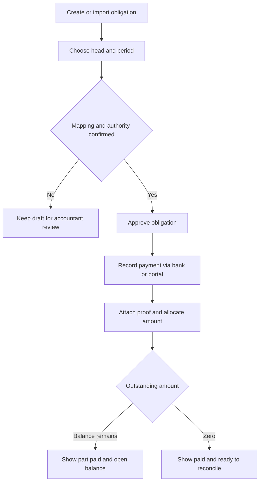

# Industrial ERP · Pakistan tax and statutory payments

## What the owner drew

The zoomed photo reads **Sales Tax, Income Tax, Customs Duty, Professional, PESSI, and Labour**. Use “Professional Tax” as the proposed UI label and confirm the meaning. Keep “Labour” visible as a pending configuration item until the owner supplies a sample notice, invoice or challan and the accountant confirms the authority, legal head, and posting. Treat these as distinct heads inside **Accounts → Statutory Payments**, with a shared payment and accounting engine. The payments module also has separate views for utilities, supplier payments and petty cash.

## Proposed per-head fields and treatment

| Head | Data and evidence | Accounting and workflow decision |
| --- | --- | --- |
| **Sales Tax** | Authority/regime, registration number, tax period, return or assessment reference, obligation amount, payment slip/PSID and payment confirmation such as CPR where applicable. | Separate invoice output tax, permitted input credits and payment of the resulting payable. Withholding is its own scenario when applicable. Ask Accounts whether federal goods or provincial services rules apply to any activity. |
| **Income Tax** | Tax year or withholding period, payment subtype, relevant approved section if used, taxpayer or withholding-agent details, PSID/CPR where applicable, challan/evidence. | Distinguish the company’s own tax, advance/adjustable tax as applicable, and tax withheld from vendors/employees for remittance. Track tax withheld **by customers** against eligible customer receipts and the approved tax account. |
| **Customs Duty** | Import consignment, GD or Single Declaration reference, assessment/payment reference, supplier or clearing agent, import cost breakdown, linked receipt/items where applicable. | Confirm how duties and other import charges enter landed cost, expense, or settlement of a booked payable. Keep import sales tax and income-tax amounts as their own components if present. Allocate landed cost using a signed rule, such as quantity, value or weight, and handle quantities already consumed with the approved valuation/COGS treatment. |
| **Professional Tax** | Jurisdiction and authority, enrollment/demand reference where issued, tax year, assessment, deposit slip/ePay reference where applicable, and paid proof. | For the Punjab workflow, implement recording against the owner’s actual assessment and payment evidence. Keep rates and classification in accountant-approved setup. |
| **PESSI** | Employer registration/reference, contribution period, establishment, applicable employee summary or import, approved due amount, authority document and payment proof. | Track PESSI as its own head and liability mapping. Source accrual from approved payroll components or entered authority assessment as agreed. Confirm coverage, contribution basis, filing cadence and current portal process using the client’s registration and documents. |
| **Labour** | Pending owner definition. Capture authority, purpose, registration/case reference, period and evidence once identified. | Ask whether this line is a welfare payment, another government obligation, or an internal wage-related payment. Keep bank posting unavailable until the correct identity, authority and account mapping are approved. |

FBR provides payment slip generation for income and sales tax and describes CPR as payment evidence. Pakistan Single Window describes a Single Declaration import process with payment breakdown and PSID generation. Punjab Excise describes Professional Tax assessment and deposit/ePay routes. Use those sources to model references and evidence on the screens. Ask the client for current category-specific records to determine which fields are mandatory for their installation. [FBR Tax Asaan e-payments](https://help.fbr.gov.pk/?p=5667) · [FBR income-tax CPR](https://www.fbr.gov.pk/categ/income-tax/51147/40850/81158) · [Pakistan Single Window import documentation](https://www.psw.gov.pk/public/single-declaration-import) · [Punjab Excise Professional Tax](https://excise.punjab.gov.pk/professional_tax)

## Screen and workflow

- **Register.** Default columns: payment head, authority, period, due date, amount due, amount paid, outstanding, evidence status and approval status. Show due/overdue, part-paid, paid and reconciled from the underlying records. Use a separate status for an obligation assessment, an actual payment, and reconciliation.
- **New statutory obligation.** Head, authority, registration, period, due amount, due date and source. Attach assessment or calculation summary. Show account mapping to the approver. Where the liability already comes from payroll or invoicing, link or reconcile the obligation to those postings, so approving a schedule does not create the same liability twice.
- **Record payment.** Choose approved obligation(s), date, account, mode and amount allocation. Record portal/payment ID and actual proof separately. An amount can be paid in instalments. Permit one bank payment covering multiple items only under the approved grouping policy. Control duplicate evidence/reference with issuer and reference type scope. If a real payment occurred and proof is pending, record that fact according to the accounting policy and retain a proof-pending state.
- **Post and reconcile.** For an existing liability, a standard remittance debits the relevant payable and credits the correct bank/cash account. Payment for a permitted direct expense, prepayment or capitalized import cost uses its approved posting path. Capture original and reversal references. Review ledger totals by head, period and authority alongside GL balances and bank statement entries.

## Offline records and external compliance

The offline edition records and approves internal obligations, posts internal vouchers, stores evidence and exports reports. Users obtain external references and submit or pay on the applicable online service when connectivity and the approved workflow allow it. Record outbound invoice submission, acknowledgement and rejections separately if integration is required. For this client, check sales-tax registration and current FBR notices with their accountant and licensed integrator. A locally printed invoice or an invented CPR/PSID cannot stand in for the required external acknowledgement and official evidence. Confirm what the permitted outage process allows before delivering a live tax-invoice feature. [FBR digital invoicing rules and notifications](https://www.fbr.gov.pk/di-legal-provisions/173967/173968) · [FBR digital invoicing FAQ](https://www.fbr.gov.pk/faqs/173967/173969)

The complete paper lists payment categories and selected voucher fields. It supplies no rates, due dates, eligibility or prescribing notices. Keep those values effective-dated and controlled by Accounts after verification. Preserve attachment IDs/checksums and historical mapping on posted records. The initial release can accept accountant-entered amounts and approved evidence, which lets staff use the system while validated integrations are scoped. The PESSI and Labour implementation require owner documents before rate or filing automation is added.
