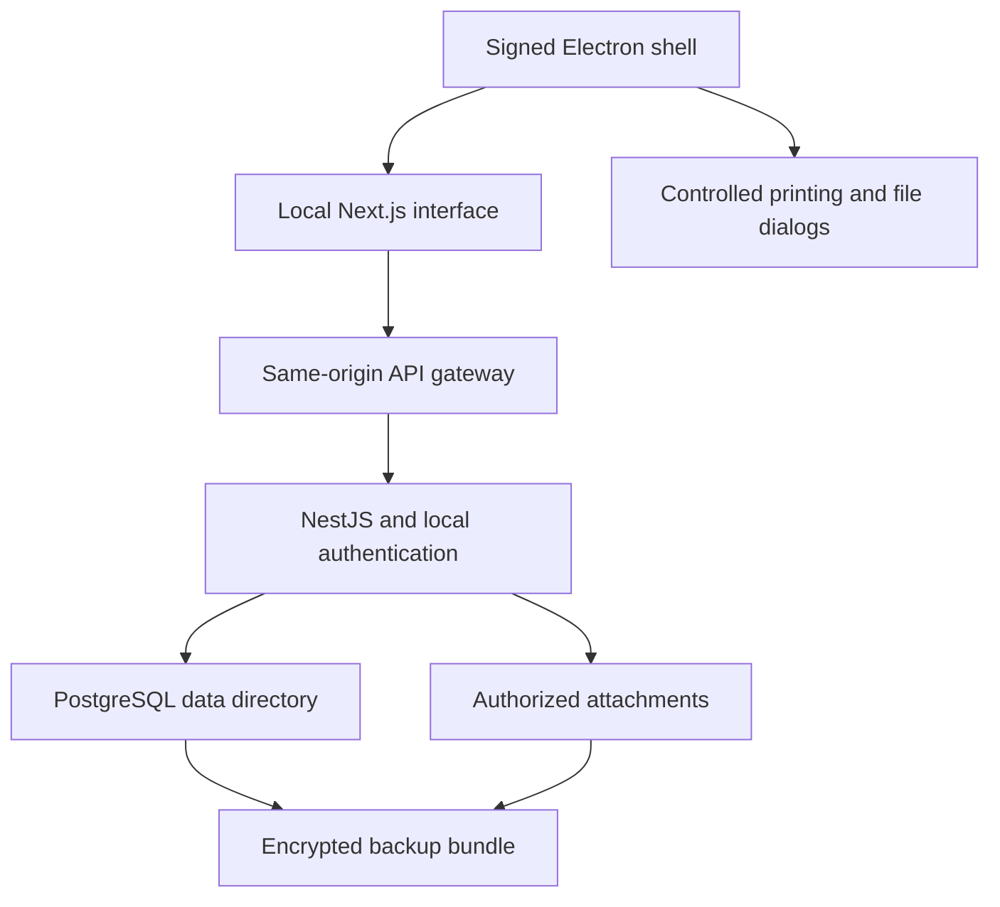
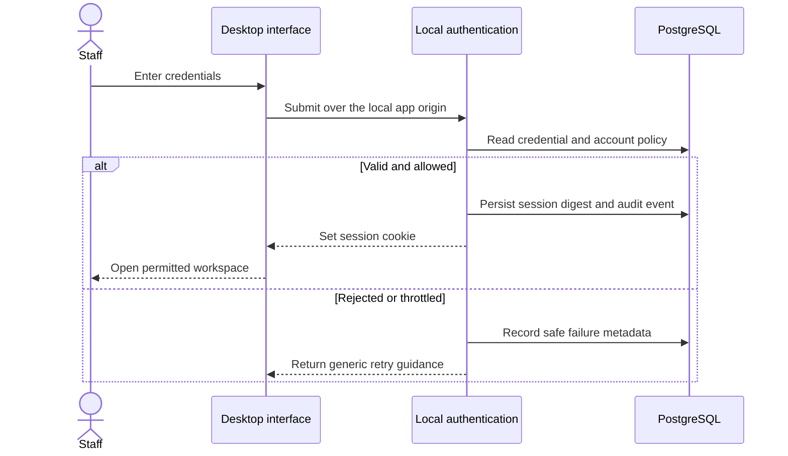

# Industrial ERP · Offline desktop and secure login

## Deployment architecture

Retain Next.js/React, NestJS, Prisma and PostgreSQL. Add an Electron Windows shell with a signed installer. Package all runtime dependencies, fonts, images, migrations and printer templates needed for offline installation and operation. Check the actual dependency lockfiles and Windows support before pinning compatible Electron, Node, Prisma and PostgreSQL patch versions. If server-dependent Next.js routes are present, package the standalone server and its static assets. Run startup/readiness checks before opening the workspace. [Next.js standalone output](https://nextjs.org/docs/app/api-reference/config/next-config-js/output) · [Electron code signing](https://www.electronjs.org/docs/latest/tutorial/code-signing)

| Topology | Implementation |
| --- | --- |
| First release, single Windows PC | Electron manages startup and health. Bind local UI/API/DB listeners to loopback. Proxy browser API requests through a trusted same-origin path with explicit routes. Use separate least-privilege runtime and migration DB roles. Keep program and business data directories separate. A privileged maintenance operation owns install/upgrade. |
| Multiple office PCs | One office host runs the app/API/DB. Use a trusted HTTPS endpoint on the private LAN for workstations. Keep PostgreSQL behind the API. Desktop clients authenticate to that host. Test network loss, client retries, simultaneous data entry and host restart. If the host is unavailable, show a reconnect state and keep posting unavailable until service returns. |
| Truly disconnected sites | Put database synchronization outside the first release scope. Confirm ownership, conflict rules, numbering and legal responsibilities before designing it. |

Inspect Redis usage. If required queues, locks or jobs depend on Redis, port or package the dependency deliberately and prove equivalents in tests. Remove Redis from the installer only after verifying all required behavior. Confirm whether Supabase is used beyond login, including storage, queries or edge services. Replace every required external dependency in offline mode through the appropriate local service.

## Local account experience

**First run.** A trusted installer or local setup utility creates the initial company and owner with a one-time bootstrap mechanism restricted to the local installation and authorized OS user. Generate a high-entropy short-lived bootstrap secret outside the renderer if the design uses a token. Consume bootstrap atomically with owner creation, require it during setup only, and disable bootstrap afterward. Prevent two concurrent first-run attempts from creating competing owners. The bootstrap route must never re-open automatically on a database error or restore.

**Sign-in.** Provide username or configured local email and password, a visible password toggle, paste/password-manager support, and a clear local recovery action. Avoid shared accounts. Compare credentials server-side, use generic errors, apply persisted/account-aware throttling with backoff and a bounded recovery path. Use separate low-risk feedback for “service unavailable” and credential failures. Use Argon2id with unique salts and benchmark costs on the target PC. For the password-only design, choose a 15-character minimum, permit at least 64 characters, check a locally available common/compromised-password blocklist, and support password changes on suspected compromise or privileged reset. Keep optional MFA for an approved later requirement, unless the client’s access policy requires it upfront. [NIST SP 800-63B-4](https://pages.nist.gov/800-63-4/sp800-63b.html) · [OWASP password storage](https://cheatsheetseries.owasp.org/cheatsheets/Password_Storage_Cheat_Sheet.html)

**Sessions.** Use high-entropy opaque session tokens. Store their digests and revocation state server-side. Set `HttpOnly` and restrictive `SameSite` cookies and `Secure` on HTTPS. For the single-PC build, validate cookie behavior and the chosen local transport on packaged Chromium. If the local transport uses HTTP, bind it to loopback only and document the shared Windows-host trust assumption. Use trusted HTTPS for LAN and keep certificate checks enabled. Keep bearer tokens, passwords and session responses out of `localStorage`, logs and error reports. Use exact origin/host validation and a CSRF defense for state changes. Rotate the token at authentication and relevant privilege changes. Apply documented idle and absolute limits, such as 15 minutes of idle lock and one work shift maximum by default, with a configurable approved policy. Re-authenticate for sensitive actions where warranted. Lock should require fresh verification before sensitive data reappears and preserve draft work safely. Revoke sessions on logout, password reset, account disable and membership changes as applicable. Revoke all restored sessions before allowing use of a recovered database. [OWASP session management](https://cheatsheetseries.owasp.org/cheatsheets/Session_Management_Cheat_Sheet.html) · [OWASP CSRF prevention](https://cheatsheetseries.owasp.org/cheatsheets/Cross-Site_Request_Forgery_Prevention_Cheat_Sheet.html)

**Recovery.** An authorized admin resets another user with an expiring one-time setup credential and audit entry. Require the affected user to set their own password, then revoke prior sessions. For sole-owner recovery, use a customer-held one-time recovery method or an authorized local recovery procedure with explicit OS/admin verification, audit and forced credential rotation. Protect against accidentally disabling/removing the last owner. Migrate existing user identities and role associations. Enroll each user in the local desktop edition using verified administrative provisioning.

## Roles and control points

| Candidate role | End-to-end access to verify |
| --- | --- |
| Owner/admin | Manage local users, roles, installation and configuration. Separate accounting actions where the owner needs segregation. |
| Accounts | Draft/post invoices, receipts, payments and statements according to policy. Reversal, posting approval and period close are distinct permissions. |
| Stores | Receive, issue and transfer in assigned warehouses and read required stock reports. Restrict financial visibility to the approved role. |
| Payroll | View employee wage rates and payroll data as authorized. Prepare or approve payroll according to assigned actions. |
| Auditor/read-only | View and optionally export approved statements and voucher evidence within company/branch permissions. |

Use NestJS guards and service-level scoping for every protected request, including nested writes, by-ID reads, downloads, exports, background actions and recovery. Sidebar visibility helps navigation. The server decides authorization using the authenticated user and verified scope. Enforce a maker/checker separation where the client requires two users. Agree with the owner how a one-person office approves transactions. Audit login success/failure, account changes, attempted privileged actions as appropriate, posting, reversal, exports and restore with minimal sensitive content.

## Desktop boundaries and data recovery

Disable privileged renderer access and enable Electron context isolation and sandboxing. Load the packaged trusted UI with a restrictive Content Security Policy, allowlisted navigation and limited IPC. Validate sender and payload in the main process. Use OS file dialogs for import/export and enforce file type/size and bounded attachment handling. Keep credentials protected using OS permissions or the OS credential store as appropriate. Treat the Windows host administrator as part of the local trust boundary. Require supported signed update installers and an authenticated recovery process. [Electron security recommendations](https://www.electronjs.org/docs/latest/tutorial/security)

Keep a service-managed data directory with appropriate access controls and a startup path that can differentiate missing storage, unavailable DB, migration failure and unsupported application/database version. Use health checks, mutually compatible build and schema versions, safe logs, and graceful service shutdown. Keep support information accessible without exposing credentials or payroll data. Validate the installer on a clean Windows machine, including packaged PostgreSQL initialization, migrations, secure local setup, font rendering and print/PDF.

Use a PostgreSQL consistent dump and a written method to capture corresponding attachment manifests, files and configuration at the same logical cutoff. Use scheduled and manual backups with integrity checks, encryption and a client-agreed copy outside the PC. Keep decryption/recovery information available to authorized users independently of a failed machine. Restore to a separate verified database on a clean host and compare reconciled totals, sample voucher PDFs and attachments. Discard or revoke restored sessions before service starts, review access and permission configuration, and preserve audit history. [PostgreSQL backup and restore](https://www.postgresql.org/docs/16/backup.html)

Review and remove the README’s documented production-facing instant admin path and development identity behavior from the delivered build. Use a separate unshipped development configuration for test accounts. Rotate any example credentials copied into live use. Test repository-level enrollment, authentication and authorization with the evidence matrix in [06_Agent_Implementation_and_Acceptance.md](06_Agent_Implementation_and_Acceptance.md).
